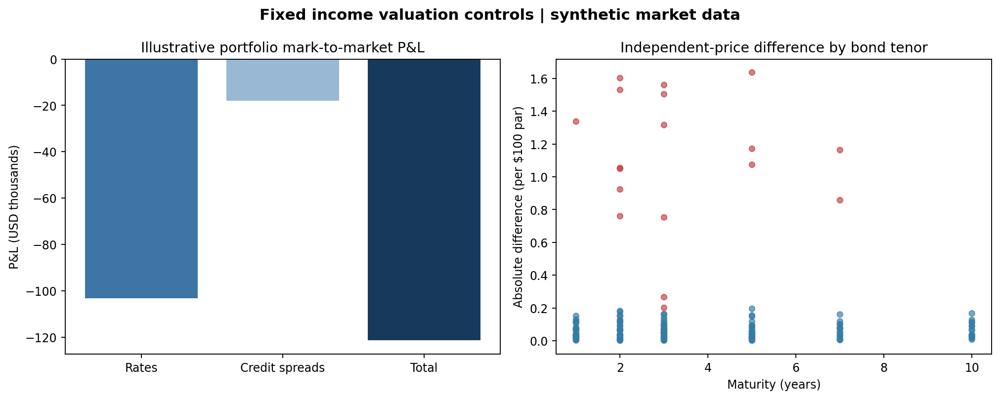

# Fixed Income Valuation & P&L Attribution

**Reproducible financial analytics portfolio project | Python · Excel · risk controls · data visualization**



## Executive summary

A transparent, end-to-end **simulation** of fixed-income portfolio valuation, P&L attribution, and independent price checking. The model prices 160 synthetic fixed-coupon bonds, measures the impact of rates versus spreads, compares desk marks with three simulated vendor quotes, and generates a prioritized review queue. All inputs are intentionally synthetic; this is **not a real trading book, a bank IPV process, a regulatory fair-value statement, or an approved valuation-adjustment methodology**.

### Reproducible findings (seed `20261119`)

| Measure | Result | Interpretation |
|---|---:|---|
| Bonds / notional principal | **160 / $55.60M** | Simulated fixed-coupon portfolio |
| End-period portfolio market value | **$56.14M** | Modeled clean-price market value |
| Simulated mark-to-market P&L | **−$121.27K** | Market movement, not actual realized losses |
| Rate-driven P&L | **−$103.21K** | 85.1% of modeled P&L by magnitude |
| Spread-driven P&L | **−$18.06K** | Remaining explanatory component |
| Flagged independent-price differences | **18 (11.25%)** | Differences exceeding illustrative tolerances |
| Sum of beyond-tolerance pricing differences | **$58.21K** | *Illustrative magnitude*, not a booked VA |
| Aggregate DV01 | **$17.08K per bp** | Approximate local price sensitivity to 1bp yield decline |

> Findings are generated by `src/model.py`; the figures are **not predetermined targets**. Scenario and vendor-noise assumptions influence results. Numbers may differ slightly in Excel owing to input rounding.

## Why this matters

For product control and valuation-control teams, a pricing difference is not an answer in itself. The process must distinguish market-driven P&L from anomalous marks, cross-check independent references, apply consistent tolerances, and turn exceptions into a review queue. This project demonstrates that analysis, while making no claim to substitute for bank policy.

## Method

1. **Portfolio generation:** 160 government, investment-grade, and high-yield bonds with synthetic coupons, maturities, face amounts, credit spreads, yield changes, and coupon accrual fractions
2. **Bond pricing:** Semiannual fixed-coupon discounted cash flows. Discount future payments over fractional coupon periods to estimate dirty prices, subtract straight-line accrued interest for clean-price comparison
3. **P&L attribution:** Reprice each position first for benchmark yield changes, then for credit-spread changes. Summed components reconcile to total modeled market P&L (within rounding)
4. **Price verification:** Generate three independent *simulated* vendor quotes per bond and compare the desk mark against their median (robust to a single extreme quote)
5. **Exception management:** Flag absolute gaps exceeding **0.20 price points per $100 par** (government / investment grade) or **0.30** (high yield), and rank by excess difference times position face
6. **Controls and reporting:** Export the exception queue, sector summary, Excel review workbook, and visualization; test pricing monotonicity, par pricing, yield inversion, determinism, and P&L attribution

### Calculation details

With semiannual coupon `C = 100 × coupon / 2`, elapsed coupon fraction `a`, yield `y`, and `N` remaining payments:

- Dirty price: `Σ CF_k / (1 + y/2)^(k−a)`, for k = 1,...,N
- Accrued interest: `C × a`
- Clean price: `dirty price − accrued interest`
- Rates P&L: `(P(y_start + Δrate, spread unchanged) − P_start) × face/100`
- Spread P&L: `(P_end − P_after_rates) × face/100`
- Model IPV gap: `desk price − median(vendor A, vendor B, vendor C)`
- Illustrative **beyond-tolerance pricing difference**: `max(0, |gap|−tolerance) × face/100`

The beyond-tolerance measure **must not be described as an actual valuation adjustment or reserve**. Formal VA depends on instrument type, accounting framework, model uncertainty, liquidity, bid/ask practices, observability, and governing policy. Attribution is sequential; order changes individual components. All results are *scenario illustrations* rather than live market prices.

## Files

```text
fixed-income-valuation-control/
├── README.md
├── requirements.txt
├── Fixed_Income_Valuation_Control.xlsx  # Formula-based IPV control review + pricing example
├── src/
│   ├── model.py                           # Synthetic portfolio, pricing, attribution and checks
│   └── visualize.py                       # Output chart
├── data/
│   └── synthetic_bond_positions.csv       # All generated inputs and model outputs
├── outputs/
│   ├── analysis_dashboard.png
│   ├── ipv_exception_queue.csv
│   ├── metrics.json
│   └── sector_summary.csv
└── tests/
    └── test_model.py
```

The workbook has an **Overview**, **IPV Controls** (editable desk/vendor inputs and formula-derived flags), **Bond Pricing** (a cash-flow valuation example), and **Assumptions** sheet. The workbook's bond pricing example is a coupon-date illustration, while the Python engine handles fractional coupon accrual.

## Run locally

```bash
python -m venv .venv
source .venv/bin/activate  # On Windows: .venv\Scripts\activate
pip install -r requirements.txt
python src/model.py
python src/visualize.py
python -m pytest -q
```

You can also inspect `Fixed_Income_Valuation_Control.xlsx` without running the scripts. The key checks are re-calculated directly in spreadsheet formulas.

## Scope and limitations

- **Synthetic data only**; no bank, customer, trading, or licensed price data
- Synthetic *independent* vendor quote streams are simulated, not sourced from actual market-data providers
- Flat YTM per instrument rather than calibrated market discount curves, option-adjusted spreads, or derivatives-specific models
- Coupon frequencies and fractional periods simplified; no holiday calendars, day-count conventions, callable features, FX, or transaction fees
- Market P&L is price-based and excludes carry, trading, funding, realized proceeds, and actual desk close methodology
- Example tolerance limits are educational, **not** global IPV policy
- No financial, investment, valuation-control, or audit assurance claims


## Author

Portfolio demonstration project; all findings and market inputs synthetic. Date: November 2026.
